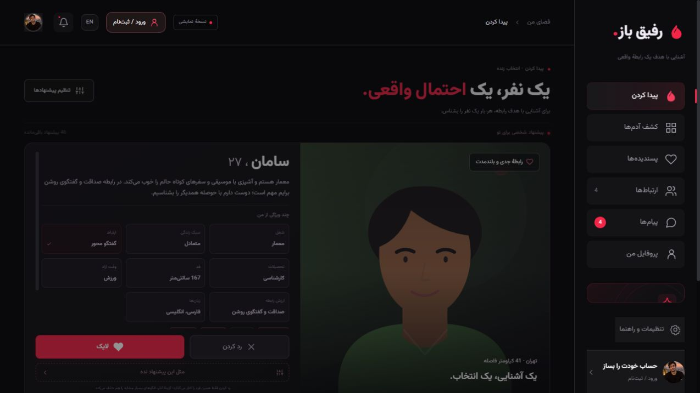
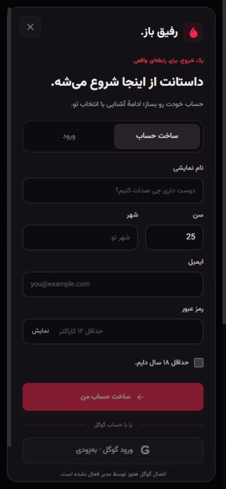

<div align="center">
  
  <h1>رفیق باز · Rafiq Baz</h1>
  <p><strong>A Persian-first dating experience, built for intentional relationships.</strong></p>
  <p>Angular · Python / FastAPI · SQLite · Capacitor · Android & iOS</p>
  <p>
    <a href="https://github.com/itzhoman/rafiq-baz/actions/workflows/checks.yml"></a>
    
    
    
  </p>
  <p><a href="https://rafiq-baz-vercel-static.vercel.app/">Live demo</a> · <a href="#quick-start">Run locally</a> · <a href="#screenshots">Screenshots</a> · <a href="#features">Features</a> · <a href="#project-status">Project status</a> · <a href="#فارسی">فارسی</a></p>
</div>



Rafiq Baz explores how thoughtful profiles, clear relationship intentions and simple choices can make meeting someone feel more personal. Its matte-black and crimson interface pairs Persian RTL and English LTR layouts with a shared web/mobile application.

**v0.3.0 is a working prototype.** It includes a Python account service and 110 fictional adult profiles for exploring the complete experience. Sample likes, presence indicators, connections and conversations do not represent real people.

**[Try the public Vercel demo](https://rafiq-baz-vercel-static.vercel.app/)** · **[Mobile flow](https://rafiq-baz-vercel-static.vercel.app/mobile?view=find)**. The hosted build is an interactive Angular demo with fictional profiles and browser-local state. Run the Python service locally for real email/password account flows; the public demo does not host the API.

## Features

- **One person at a time:** like, pass or choose “don’t suggest people like this.” Restore a hidden pattern without clearing previous choices.
- **Personalized suggestions:** relationship goals, shared interests and self-declared attributes influence ranking. The UI explains each suggestion; it does not invent compatibility percentages.
- **Your own profile:** editable introduction, interests, relationship goal and up to 12 custom attributes.
- **Discovery controls:** age, distance, interest and online filters, nearby sorting and saved profiles.
- **Complete sample data:** 110 fictional adults, including 100 additional profiles with bilingual biographies, first-date prompts and eight personal attributes each.
- **Account flows:** email/password registration, sign-in, sign-out and account-owned state on the Python deployment. Google Identity Services integration is ready for OAuth configuration.
- **Conversation flow:** mutual demo connections, conversation list and persisted sample messages.
- **Responsive UI:** Persian/English, self-hosted Vazirmatn, coordinated transitions and reduced-motion support.
- **Shared mobile code:** Capacitor Android and iOS projects plus a service-worker-enabled web app.

## Screenshots

<table>
  <tr>
    <th>Find someone · mobile</th>
    <th>Create an account · Python deployment</th>
  </tr>
  <tr>
    <td align="center"></td>
    <td align="center"></td>
  </tr>
</table>

## Tech stack

| Layer | Implementation |
| --- | --- |
| Frontend | Angular 21, standalone components, signals, OnPush, zoneless change detection |
| Styling | CSS, responsive layouts, self-hosted Vazirmatn variable font |
| Backend | Python 3.13, FastAPI, Pydantic |
| Persistence | SQLite, WAL mode, transactional state updates |
| Accounts | Salted scrypt passwords, HttpOnly cookie sessions, hashed session tokens |
| Mobile | Capacitor 8, Android and iOS native projects |
| Checks | GitHub Actions, Node behavioral tests, Python unittest |

## Quick start

Install **Node.js 22.12+ or 24.x**, **npm**, and **Python 3.13**. Run from the repository root.

```bash
git clone https://github.com/itzhoman/rafiq-baz.git
cd rafiq-baz
npm ci
npm run build
python -m venv .venv
```

**Windows / PowerShell**

```powershell
.venv/Scripts/python.exe -m pip install -r backend/requirements.lock.txt
.venv/Scripts/python.exe -m uvicorn backend.app:app --host 127.0.0.1 --port 8000
```

**macOS / Linux**

```bash
.venv/bin/python -m pip install -r backend/requirements.lock.txt
.venv/bin/python -m uvicorn backend.app:app --host 127.0.0.1 --port 8000
```

Open [the application](http://127.0.0.1:8000/?view=find) or [the mobile layout](http://127.0.0.1:8000/mobile?view=find). Use **ورود / ثبت‌نام** in the header to try account creation. A new account starts with its own profile and no inherited demo messages or connections.

For frontend-only development, run `npm start` and open `http://localhost:4200`. This mode uses browser-local sample state and does not create real accounts.

## Accounts and configuration

The Python server serves both the production Angular build and `/api/v1` from the same origin. Its `/runtime-config.js` enables API mode. Static hosting and native bundles use offline sample mode by default.

| Variable | Purpose |
| --- | --- |
| `RB_DATABASE` | SQLite file path; defaults to `backend/data/demo.sqlite3` |
| `RB_GOOGLE_CLIENT_ID` | Public Google web OAuth client ID; blank disables Google sign-in |
| `RB_SECURE_COOKIES` | Set `1` for production HTTPS / TLS termination |
| `RB_ALLOWED_ORIGINS` | Extra browser origins allowed by the auth request-origin check |

Set environment variables before starting the server. [`backend/.env.example`](backend/.env.example) is a reference file and is not automatically loaded. Never commit a database, session token or private configuration file.

Google login validates ID tokens on the server, uses a one-use nonce and identifies returning users by Google's `sub`. Creating a valid OAuth client and registering the deployment's JavaScript origin are required before real Google login can work. See [account setup and deployment boundaries](docs/accounts.md).

## Android and iOS

```bash
npm run mobile:sync
npm run mobile:android
# On a Mac:
npm run mobile:ios
```

- **Android:** Java 21 and Android SDK 36. Windows users can run `./scripts/build-android.ps1` for a debug APK. See the helper for the opt-in Maven mirror fallback if your environment cannot reach Google Maven.
- **iOS:** open `ios/App/App.xcodeproj` in Xcode on macOS, choose a signing team and build for a simulator/device. iOS source has been synchronized; a signed IPA has not been produced.
- Native bundles currently contain the offline sample application. Connecting real mobile accounts and native Google authentication is part of the roadmap.

## Checks

```bash
npm run build
npm run test:recommendations
npm run test:profiles
python -m unittest discover -s backend -v
```

Use the virtual environment's Python for the last command. The suite includes **six recommendation tests, one complete-fixture check and sixteen Python test groups**. It covers ranking, feedback/undo, filters, validation, state migration, account isolation, password login, cookie expiry/revocation, request-origin protection, throttling and Google nonce/verification integration. Google verification is mocked at its library boundary in automated tests.

## Performance and architecture

Signal-derived state and OnPush components limit unnecessary work. The account form loads only when opened; all 110 profiles load as a separate JSON resource. Images and fonts are local assets, secondary images load lazily, and animations respect `prefers-reduced-motion`.

The v0.3 production build estimates **85.88 kB compressed initial code/styles**, excluding fonts, data, images and HTTP overhead. This is a build estimate, not a production latency or load benchmark. Full measurements and verification limits are in [verification notes](docs/verification.md).

```text
src/app/       Angular screens, account UI, state store and recommendation rules
backend/       FastAPI, account sessions, SQLite persistence and tests
public/        Local fonts, fictional portraits/avatars and PWA assets
shared/        Initial demo state and original sample profiles
android/       Native Android project
ios/           Native iOS / Xcode project
scripts/       Fixture generation, checks, icon export and Android build helper
docs/          Screenshots, architecture, account setup and verification
```

## Project status

| Available | Still to build or configure |
| --- | --- |
| Web UI, one-by-one recommendations, editable attributes | Public deployment of the Python account service |
| Email accounts and isolated state on Python | Live Google OAuth configuration |
| Sample connections and persisted demo conversations | Messaging between real users, moderation and reporting |
| Android debug build; synchronized iOS project | iOS compilation/signing, device testing and store release |
| 110 fictional profiles | Consenting real-member directory, media uploads and presence |
| Account/session security checks | Email verification, password recovery, deletion and production privacy controls |

## Documentation and assets

- [Architecture](docs/architecture.md)
- [Recommendation and similarity rules](docs/finding.md)
- [Accounts and Google setup](docs/accounts.md)
- [Build and verification](docs/verification.md)
- [Original sample portraits](docs/assets-generation.md), [additional portraits](docs/assets-v0.2.md), [100-profile fixture and font](docs/assets-v0.3.md)

All profile identities are fictional adults. The sample includes generated portraits and original SVG avatar illustrations. Vazirmatn is distributed under the [SIL Open Font License](public/assets/VAZIRMATN-LICENSE.txt).

## فارسی

<div dir="rtl">

**رفیق باز** یک پروژهٔ آشنایی با هدف رابطه است؛ با رابط قرمز و مشکی، فونت وزیرمتن و پشتیبانی از فارسی و انگلیسی. در بخش «پیدا کردن» هر بار یک نفر پیشنهاد می‌شود و می‌توان او را لایک یا رد کرد، یا خواست پیشنهادهای خیلی مشابه کمتر نمایش داده شوند. هدف رابطه و ویژگی‌های شخصی روی ترتیب پیشنهادها اثر دارند.

این نسخه ۱۱۰ پروفایل دامی بزرگسال دارد. ثبت‌نام و ورود ایمیلی روی سرور پایتون کار می‌کند؛ ورود گوگل به تنظیم OAuth نیاز دارد. نسخهٔ استاتیک و اپ موبایل فعلاً با داده‌های نمایشی کار می‌کنند. گفتگوها و ارتباط‌ها نمونه‌اند و پیام واقعی برای کسی ارسال نمی‌شود.

برای اجرا، مراحل Quick start را انجام بده و آدرس محلی را باز کن. کد اندروید و iOS از همان رابط مشترک استفاده می‌کند؛ ساخت نسخهٔ iOS به مک و Xcode نیاز دارد.

</div>

---

Built by [Hooman Hajimohamadi](https://github.com/itzhoman).
